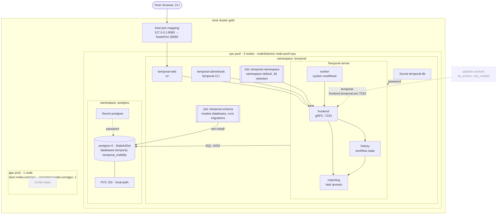
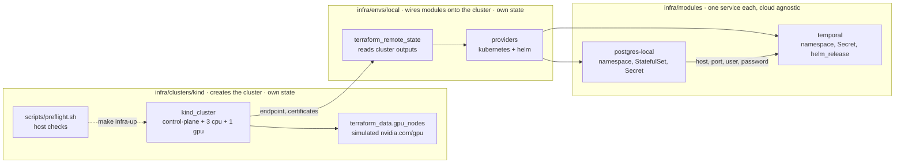

# ml-golden-stack

Reference stack for multi-model batch ML pipelines: OpenTofu, Kubernetes, Kueue and Temporal. Runs locally on kind and is designed to move to EKS or GKE by adding a cluster and an environment, without changing the service modules.

> Work in progress. The local cluster and Temporal are implemented so far.

## Layout

| Directory | Purpose | Status |
|---|---|---|
| `infra/clusters/kind` | local kind cluster | ✅ |
| `infra/modules` | cloud-agnostic service modules: `temporal`, `postgres-local` | ✅ Temporal, MLflow and MinIO planned |
| `infra/envs/local` | local environment: wires the modules onto the kind cluster | ✅ |
| `temporal` | Temporal workflows: pipeline orchestration, model promotion | planned |
| `de_worker` | data engineering worker: video decoding, segmentation, I/O | planned |
| `mle_models` | model steps behind a common batch interface | planned |

## Services

What runs in the local cluster. Dashed boxes are planned. For which pod ran on which node in one real run, see [docs/example-scheme.md](docs/example-scheme.md).



## Infrastructure layers



`clusters/*` and `envs/*` are separate OpenTofu root modules with separate state. An environment can be applied and destroyed without touching its cluster.

Everything cloud specific lives in `clusters/<name>` and `envs/<name>`:

| | kind (`envs/local`) | EKS / GKE (planned) |
|---|---|---|
| Cluster state | local file | S3 / GCS |
| Provider auth | client certificate | `aws eks get-token` / Google access token |
| Postgres | `modules/postgres-local` | RDS / Cloud SQL, same inputs to `modules/temporal` |
| Temporal UI | NodePort + kind port mapping | Ingress or internal LoadBalancer |
| History shards | 4 | 512 |
| GPU | simulated: fake `nvidia.com/gpu` on the `gpu` pool | real GPU node group; EKS: NVIDIA device plugin, GKE: built in |

Moving to a cloud means adding `clusters/eks` and `envs/eks` (or `gke`); `modules/*` stay as they are.

### Cluster contract

Every cluster must provide:

- worker pools labelled `node-pool=<name>`: `cpu` for platform services, `gpu` for model steps;
- GPU nodes tainted `nvidia.com/gpu=present:NoSchedule` and advertising `nvidia.com/gpu`;
- a default StorageClass;
- outputs: `endpoint`, `cluster_ca_certificate`, credentials for the providers.

Node selectors, tolerations and Kueue flavors written against this contract work unchanged in every environment.

## Local cluster

| Node | Pool label | Capacity label | Taint |
|---|---|---|---|
| control-plane | — | — | `node-role.kubernetes.io/control-plane:NoSchedule` |
| 3 × worker | `node-pool=cpu` | `capacity-type=on-demand` | — |
| 1 × worker | `node-pool=gpu` | `capacity-type=spot` | `nvidia.com/gpu=present:NoSchedule` |

Three `cpu` nodes let replicated services run one replica per node. Pools, sizes, labels and taints are configured through the `node_pools` variable.

### Simulated GPU

The `gpu` pool has no real GPU. Its nodes advertise a fake `nvidia.com/gpu` resource (set by `infra/clusters/kind/scripts/setup-gpu-nodes.sh` after the cluster is created) and carry the label `gpu-simulated=true`.

GPU pods request `nvidia.com/gpu` and tolerate the taint exactly as on cloud GPU nodes, so their manifests and Kueue flavors are the same everywhere. They schedule locally but run on CPU: model code has to fall back to CPU when no CUDA device is present.

### Exposed services

NodePort → `127.0.0.1`:

| Service | URL |
|---|---|
| Temporal UI | http://127.0.0.1:8080 |
| MLflow | http://127.0.0.1:5000 (planned) |
| MinIO console | http://127.0.0.1:9001 (planned) |

### Requirements

- [OpenTofu](https://opentofu.org/docs/intro/install/) ≥ 1.8
- Docker (Podman works with `KIND_EXPERIMENTAL_PROVIDER=podman`)
- kubectl
- ~4 GB of free RAM for the cluster and platform services
- Linux: raised inotify limits, see below

The `kind` CLI is not required: the cluster is created by the `tehcyx/kind` provider.

`make infra-up` runs `make preflight` first: it checks the tools, the docker daemon, inotify limits and free memory. It never changes the host, it prints the commands to fix what is missing.

#### inotify limits

Every kind node runs its own kubelet, containerd and kube-proxy, all using inotify on the host kernel. Distro defaults (usually 128 instances) are enough for about three nodes. With more, kube-proxy crashes with `too many open files` and pods lose access to services and DNS ([kind known issue](https://kind.sigs.k8s.io/docs/user/known-issues/#pod-errors-due-to-too-many-open-files)). Raise the limits once:

```bash
sudo sysctl fs.inotify.max_user_watches=524288 fs.inotify.max_user_instances=512
printf 'fs.inotify.max_user_watches = 524288\nfs.inotify.max_user_instances = 512\n' \
  | sudo tee /etc/sysctl.d/99-kind.conf   # keep after reboot
```

### Usage

```bash
make infra-up          # create the cluster
make platform-up       # Postgres + Temporal
export KUBECONFIG=$PWD/infra/clusters/kind/.kubeconfig
make infra-status      # nodes, pools, taints, GPUs
make platform-status   # platform pods

make platform-down     # always before infra-down
make infra-down
```

The kubeconfig is written to `infra/clusters/kind/.kubeconfig` (gitignored), so `~/.kube/config` is left untouched.

## Platform services

### Temporal

| Part | How it runs |
|---|---|
| Server (frontend, history, matching, worker) | official `temporalio/temporal` chart, one replica each |
| Persistence and visibility | Postgres from `modules/postgres-local` in the `postgres` namespace, databases `temporal` and `temporal_visibility` |
| Schema | created and migrated by the chart's schema job (pre-install / pre-upgrade hook) |
| Namespaces | `default` with 3 days retention, created by the chart's namespace job |
| UI | http://127.0.0.1:8080 (NodePort 30080) |
| Frontend for workers | `temporal-frontend.temporal.svc:7233` |

`modules/temporal` takes the database as inputs (`db`, `db_password`) and knows nothing about where it runs. Locally it gets the in-cluster Postgres, in the cloud a managed database. Postgres lives in its own namespace for the same reason: to Temporal it is an external database, as RDS would be.

All platform pods are pinned to `node-pool=cpu`. Local Postgres has no replication and no backups. Its password is generated by OpenTofu, stored in the state and in the `postgres` and `temporal-db` Secrets.

`numHistoryShards` is 4 locally and cannot be changed after the first install without recreating the database (`make platform-down && make platform-up`).

For a quick check from the host:

```bash
kubectl -n temporal port-forward svc/temporal-frontend 7233:7233
temporal workflow list --address 127.0.0.1:7233
```

## Versions

| Component | Version | Why |
|---|---|---|
| `tehcyx/kind` provider | `~> 0.11` | bundles kind v0.31 |
| Kubernetes node image | `v1.35.0` | default image of kind v0.31, pinned by digest |
| `temporalio/temporal` chart | `1.7.0` | server 1.32.0, UI 2.54.1 |
| Postgres | `17.11-alpine` | |
| `hashicorp/helm` provider | `~> 3.3` | |
| `hashicorp/kubernetes` provider | `~> 3.3` | |
