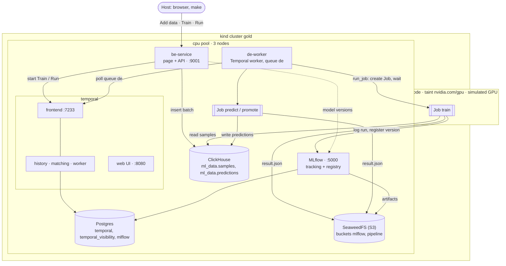
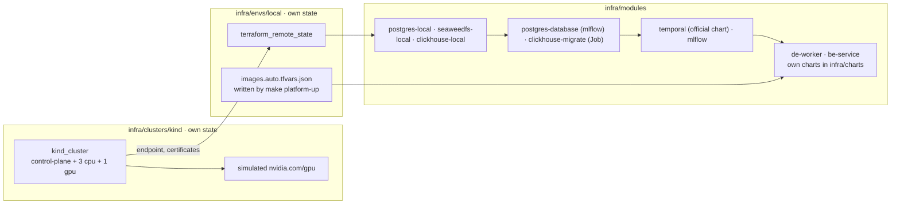

# ml-golden-stack

Reference stack for multi-model batch ML pipelines: OpenTofu, Kubernetes, Kueue and Temporal. Runs locally on kind and is designed to move to EKS or GKE by adding a cluster and an environment, without changing the service modules.

> The first end-to-end pipeline runs: a page with three buttons adds MNIST data, trains a model on the (simulated) GPU pool and runs it, through Temporal, Kubernetes Jobs, ClickHouse and MLflow. Kueue, the cloud environments and the items in [BACKLOG.md](BACKLOG.md) are next.

## Layout

| Directory | Purpose |
|---|---|
| `infra/clusters/kind` | local kind cluster |
| `infra/modules` | cloud-agnostic modules, one service each: `postgres-local`, `postgres-database`, `temporal`, `seaweedfs-local`, `clickhouse-local`, `clickhouse-migrate`, `mlflow`, `de-worker`, `be-service` |
| `infra/charts` | Helm charts of our own applications: `de-worker`, `be-service` |
| `infra/envs/local` | local environment: wires the modules onto the kind cluster |
| `db/clickhouse/migrations` | ClickHouse schema (golang-migrate, one statement per file) |
| `be_service` | Rust: the page and its API. Adds data to ClickHouse, starts workflows in Temporal |
| `de_worker` | Python: Temporal worker. Workflows `Train`, `Run` and `Report`, activity `run_job` that runs a Kubernetes Job |
| `mle_models` | Python: `mnist` (model code, no I/O) and `jobs` (the Job entry points: train, predict, report, promote) |
| `scripts/images.sh` | builds the application images and loads them into kind |

## Services

What runs in the local cluster. For which pod ran on which node in one real run, see [docs/example-scheme.md](docs/example-scheme.md). The pipeline itself is described in [docs/first-pipeline.md](docs/first-pipeline.md).



## Infrastructure layers



`clusters/*` and `envs/*` are separate OpenTofu root modules with separate state. An environment can be applied and destroyed without touching its cluster.

Everything cloud specific lives in `clusters/<name>` and `envs/<name>`:

| | kind (`envs/local`) | EKS / GKE (planned) |
|---|---|---|
| Cluster state | local file | S3 / GCS |
| Provider auth | client certificate | `aws eks get-token` / Google access token |
| Postgres | `modules/postgres-local` | RDS / Cloud SQL, same inputs to `modules/temporal`, `modules/postgres-database` |
| Object store | `modules/seaweedfs-local` (S3 API) | S3 / GCS: same endpoint, bucket and key inputs |
| ClickHouse | `modules/clickhouse-local` | ClickHouse Cloud, same inputs to `clickhouse-migrate` and the applications |
| Images | built locally, loaded into kind (`scripts/images.sh`) | pulled from GHCR, built by CI |
| UIs (page, Temporal, MLflow) | NodePort + kind port mapping | Ingress or internal LoadBalancer |
| History shards | 4 | 512 |
| GPU | simulated: fake `nvidia.com/gpu` on the `gpu` pool | real GPU node group; EKS: NVIDIA device plugin, GKE: built in |

Moving to a cloud means adding `clusters/eks` and `envs/eks` (or `gke`); `modules/*` stay as they are.

### Cluster contract

Every cluster must provide:

- worker pools labelled `node-pool=<name>`: `cpu` for platform services, `gpu` for model steps;
- GPU nodes tainted `nvidia.com/gpu=present:NoSchedule` and advertising `nvidia.com/gpu`;
- a default StorageClass;
- outputs: `endpoint`, `cluster_ca_certificate`, credentials for the providers.

Node selectors, tolerations and Kueue flavors written against this contract work unchanged in every environment.

## Local cluster

| Node | Pool label | Capacity label | Taint |
|---|---|---|---|
| control-plane | — | — | `node-role.kubernetes.io/control-plane:NoSchedule` |
| 3 × worker | `node-pool=cpu` | `capacity-type=on-demand` | — |
| 1 × worker | `node-pool=gpu` | `capacity-type=spot` | `nvidia.com/gpu=present:NoSchedule` |

Three `cpu` nodes let replicated services run one replica per node. Pools, sizes, labels and taints are configured through the `node_pools` variable.

### Simulated GPU

The `gpu` pool has no real GPU. Its nodes advertise a fake `nvidia.com/gpu` resource (set by `infra/clusters/kind/scripts/setup-gpu-nodes.sh` after the cluster is created) and carry the label `gpu-simulated=true`.

GPU pods request `nvidia.com/gpu` and tolerate the taint exactly as on cloud GPU nodes, so their manifests and Kueue flavors are the same everywhere. They schedule locally but run on CPU: model code has to fall back to CPU when no CUDA device is present.

### Exposed services

NodePort → `127.0.0.1`:

| Service | URL |
|---|---|
| Pipeline page (be_service) | http://127.0.0.1:9001 |
| Temporal UI | http://127.0.0.1:8080 |
| MLflow | http://127.0.0.1:5000 |

ClickHouse and SeaweedFS stay inside the cluster; use `kubectl port-forward` for a look (see below).

### Requirements

- [OpenTofu](https://opentofu.org/docs/intro/install/) ≥ 1.8
- Docker (Podman works with `KIND_EXPERIMENTAL_PROVIDER=podman`)
- kubectl
- ~6 GB of free RAM: cluster, platform services and a running train Job
- Linux: raised inotify limits, see below

The `kind` CLI is not required: the cluster is created by the `tehcyx/kind` provider.

`make infra-up` runs `make preflight` first: it checks the tools, the docker daemon, inotify limits and free memory. It never changes the host, it prints what to run to fix what is missing.

#### inotify limits

Every kind node runs its own kubelet, containerd and kube-proxy, all using inotify on the host kernel. Distro defaults (usually 128 instances) are enough for about three nodes. With more, kube-proxy crashes with `too many open files` and pods lose access to services and DNS ([kind known issue](https://kind.sigs.k8s.io/docs/user/known-issues/#pod-errors-due-to-too-many-open-files)). Raise the limits once (asks for sudo, writes `/etc/sysctl.d/99-kind.conf` so they survive reboots):

```bash
make host-setup
```

### Usage

```bash
make infra-up          # create the cluster
make platform-up       # build and load the images, install platform services and applications
export KUBECONFIG=$PWD/infra/clusters/kind/.kubeconfig
make infra-status      # nodes, pools, taints, GPUs
make platform-status   # all pods and pipeline Jobs

make platform-down     # always before infra-down
make infra-down
```

`make platform-up` is the one command for everything above the cluster. It builds the three application images, tags them by content (`dev-<image id>`), loads into the kind nodes only what they miss, and applies `infra/envs/local`. A changed image gets a new tag and its pods roll; with nothing changed the apply is a no-op. `make platform-up IMAGES=remote TAG=sha-abc1234` takes the images CI published to GHCR instead.

Do not run `make` with sudo: OpenTofu state written by root cannot be updated later without it.

The kubeconfig is written to `infra/clusters/kind/.kubeconfig` (gitignored), so `~/.kube/config` is left untouched.

## Pipeline

Open http://127.0.0.1:9001 and press the buttons in order, or use make:

```bash
make add-data N=5000   # be_service adds the next 5000 MNIST examples as one batch
make train POOL=gpu    # workflow Train: Job train on the gpu pool, promote if better
make run               # workflow Run: the champion predicts all 10,000 test images
make report            # workflow Report: what the recognized digits add up to
```

Adding data and training again shows the point of the demo: accuracy grows with the data (about 64% on 1,000 examples, 95% on 10,000, 98.5% on all 60,000), and a new version becomes `champion` only when it beats the current one.

| Step | Who | Where the result goes |
|---|---|---|
| Add data | be_service, directly | `ml_data.samples`, one `batch_id` (UUID v7) per batch |
| Train | Temporal `Train` → de_worker `run_job` → Job `train` | MLflow run + new version of `mnist-cnn`, `result.json` |
| Promote | decided in the workflow, Job `promote` | MLflow alias `champion` |
| Run | Temporal `Run` → Job `predict` | `ml_data.predictions` under the run's `run_id` |
| Report | Temporal `Report` → Job `report` on the latest prediction run | `ml_data.digit_report`: per digit, how many the model recognized and how many there are |

Contracts that hold the pieces together:

- `batch_id` and `run_id` are generated by be_service per button press and travel through the workflow input, the Job arguments, ClickHouse and MLflow (`train_batches.json` lists the batches a model was trained on).
- Workflow IDs are fixed (`train`, `run`, `report`): a second press while one runs is refused by Temporal.
- `run_job` names the Job `<step>-<run_id>`: a retried activity finds the Job it created instead of starting the step again. Every step is idempotent: a partial batch or prediction run is rewritten, a complete one skipped.
- The `mnist` package has no I/O; `jobs` does ClickHouse, MLflow and S3 around it.

## Platform services

### Data and models

| Service | Module | Notes |
|---|---|---|
| ClickHouse 26.8 | `clickhouse-local` | low-memory config (512 MiB cap, system log tables off); schema only from `db/clickhouse/migrations` |
| ClickHouse migrations | `clickhouse-migrate` | stock `migrate/migrate` image, SQL from a ConfigMap; a new migration file means a new Job, nothing runs otherwise |
| SeaweedFS 4.48 | `seaweedfs-local` | single `weed server` with the S3 gateway; a Job creates the buckets |
| MLflow 3.17 | `mlflow` + `postgres-database` | own database and user in Postgres, artifacts in SeaweedFS through the server, `mlflow db upgrade` as an init container, background job execution off (~2 GiB less) |

ClickHouse and SeaweedFS from the host:

```bash
kubectl -n clickhouse port-forward svc/clickhouse 8123:8123     # http://127.0.0.1:8123/play
kubectl -n clickhouse get secret clickhouse -o jsonpath='{.data.password}' | base64 -d   # user: platform
kubectl -n seaweedfs port-forward svc/seaweedfs 8888:8888       # filer UI: http://127.0.0.1:8888
```

### Applications

| Application | Chart | Runs |
|---|---|---|
| be-service | `infra/charts/be-service` | one replica (Add data is serialized in-process), NodePort 30901 |
| de-worker | `infra/charts/de-worker` | Role to create, watch and delete Jobs and read pod logs in `de-worker` only |
| pipeline Jobs | created by `run_job` | `train` on the `gpu` pool (toleration + `nvidia.com/gpu: 1`), `predict` and `promote` on `cpu`; `ttlSecondsAfterFinished: 3600` |

### Temporal

| Part | How it runs |
|---|---|
| Server (frontend, history, matching, worker) | official `temporalio/temporal` chart, one replica each |
| Persistence and visibility | Postgres from `modules/postgres-local` in the `postgres` namespace, databases `temporal` and `temporal_visibility` |
| Schema | created and migrated by the chart's schema job (pre-install / pre-upgrade hook) |
| Namespaces | `default` with 3 days retention, created by the chart's namespace job |
| UI | http://127.0.0.1:8080 (NodePort 30080) |
| Frontend for workers | `temporal-frontend.temporal.svc:7233` |

`modules/temporal` takes the database as inputs (`db`, `db_password`) and knows nothing about where it runs. Locally it gets the in-cluster Postgres, in the cloud a managed database. Postgres lives in its own namespace for the same reason: to Temporal it is an external database, as RDS would be.

All platform pods are pinned to `node-pool=cpu`. Local Postgres has no replication and no backups. Its password is generated by OpenTofu, stored in the state and in the `postgres` and `temporal-db` Secrets.

`numHistoryShards` is 4 locally and cannot be changed after the first install without recreating the database (`make platform-down && make platform-up`).

For a quick check from the host:

```bash
kubectl -n temporal port-forward svc/temporal-frontend 7233:7233
temporal workflow list --address 127.0.0.1:7233
```

## Versions

| Component | Version | Why |
|---|---|---|
| `tehcyx/kind` provider | `~> 0.11` | bundles kind v0.31 |
| Kubernetes node image | `v1.35.0` | default image of kind v0.31, pinned by digest |
| `temporalio/temporal` chart | `1.7.0` | server 1.32.0, UI 2.54.1 |
| Postgres | `17.11-alpine` | |
| ClickHouse | `26.8.25.14` | LTS |
| SeaweedFS | `4.48` | MinIO was archived in 2026 |
| MLflow | `3.17.0` (`-full` image) | `psycopg2` and `boto3` included |
| golang-migrate | `v4.20.1` | |
| Temporal SDKs | Python `temporalio` 1.34, Rust `temporalio-client` 1.1 | |
| PyTorch | 2.14 (CPU wheels) | |
| `hashicorp/helm` provider | `~> 3.3` | |
| `hashicorp/kubernetes` provider | `~> 3.3` | |
