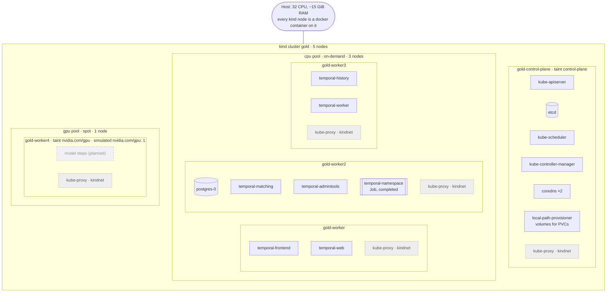

# Example scheme: pods per node

A snapshot of the local cluster taken on 2026-10-12 with `kubectl get pods -A -o wide`.

Only the pool of a pod is fixed (`cpu` or `gpu`, by node selector and taints). The node inside the pool is chosen by the scheduler, so the placement below changes every time the cluster or a pod is recreated. For the stable picture see [Services](../README.md#services) in the README.



## What to read from it

- **control-plane** runs only Kubernetes system components. Platform pods never land there because of its taint.
- **cpu pool** runs Postgres and the six Temporal components, spread over the three nodes by the scheduler.
- **gpu pool** has only the per-node system pods. Platform pods have no toleration for `nvidia.com/gpu` and select `node-pool=cpu`, so the node stays free for model steps.
- **Resources are shared.** Every node reports 32 CPU and ~15 GiB, but these are the same CPUs and memory of one laptop, not five machines.
- `kube-proxy` and `kindnet` run on every node as DaemonSets: service routing and pod networking.

## Refresh the snapshot

```bash
export KUBECONFIG=$PWD/infra/clusters/kind/.kubeconfig
kubectl get pods -A -o custom-columns='NODE:.spec.nodeName,NS:.metadata.namespace,POD:.metadata.name' | sort
```
